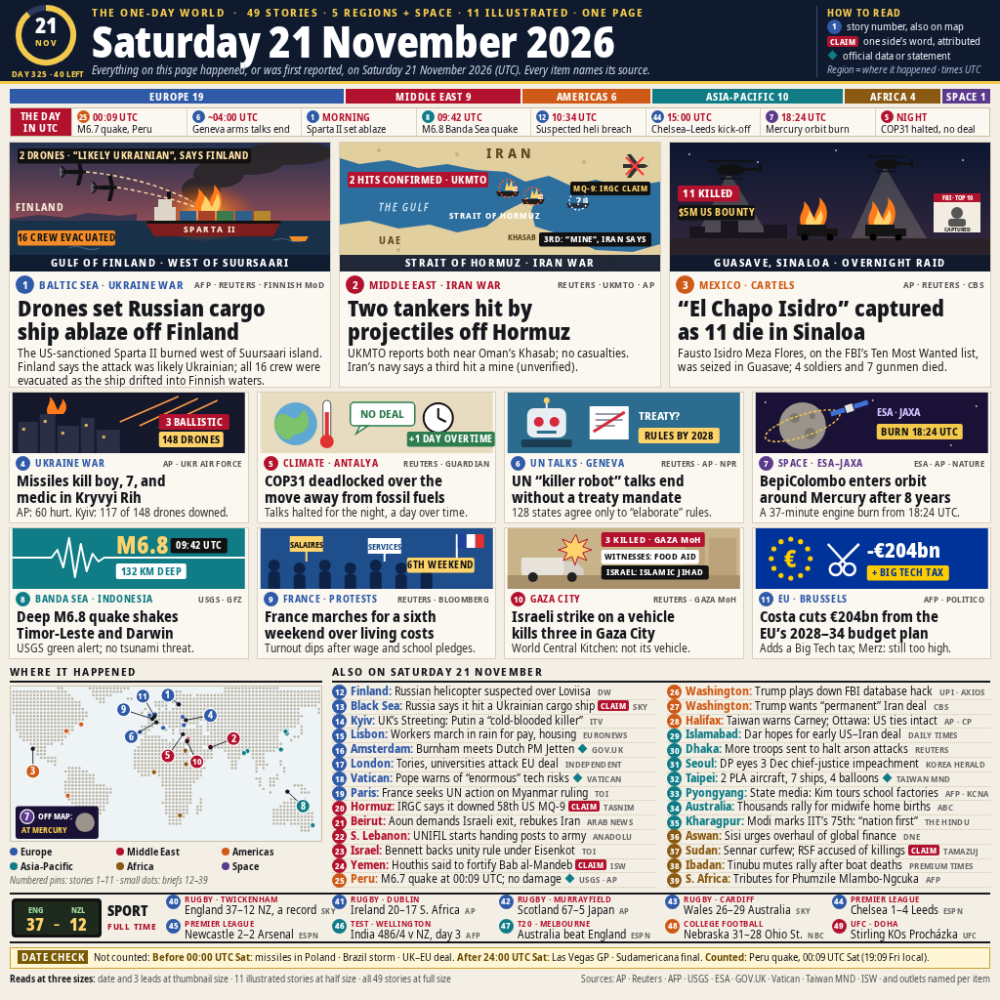

# The One-Day World: Saturday 21 November 2026

This is an entry for make.fun's "Sum up 21 November's world news in one image" bounty (`news-image-20261121`). It is a single 1024×1024 front page with **49 stories**, 11 illustrated stories and a world map. Everything on the page happened, or was first reported, on Saturday 21 November 2026 (UTC).



## What is on the page
- **Masthead:** the date in large type, with a day-of-year ring (day 325, 40 left), the story and picture counts, and a "How to read" key.
- **Region bar:** counts computed from the data (Europe 19 · Middle East 9 · Americas 6 · Asia-Pacific 10 · Africa 4 · Space 1 = 49). Each story is filed by where it happened (UN M49 grouping; Western Asia, including Turkey, counts as Middle East). Sport is filed by venue.
- **The day in UTC:** a timeline from 00:09 (the Peru quake) and about 04:00 (end of the Geneva talks) through 09:42 (the quake) and 18:24 (BepiColombo's burn) to night (COP31 halted).
- **3 illustrated leads:** Sparta II off Finland, two tankers hit off Hormuz (confirmed by UKMTO, with Iran's mine claim labelled), "El Chapo Isidro" captured in Sinaloa.
- **8 drawn cards:** Kryvyi Rih, COP31, the Geneva talks on killer robots, BepiColombo, the Banda Sea quake, France protests, Gaza vehicle strike (each side's account attributed), the EU budget.
- **Dot-matrix world map:** numbered pins for stories 1–11, coloured dots for every brief, and a Mercury inset for the story that happened off the map.
- **28 one-line briefs:** each has a place, a source, and either a **CLAIM** label (one side's word, attributed) or a ◆ mark for official data and statements.
- **Sport band:** 10 results, all finished before midnight UTC, each with its venue and source, plus a drawn scoreboard.
- **Date check:** the UTC day runs 00:00–24:00 on Saturday. Items before or after that window are left out; the Peru quake (00:09 UTC Saturday, 19:09 Friday local time) is counted.

Every story's links are listed in [SOURCES.md](SOURCES.md), which is generated from the same data as the page.

## Run
```
MAKEFUN_OUTPUT_DIR=./out python3 main.py      # or: MAKEFUN_OUTPUT_DIR=./out node main.ts
```
Without `MAKEFUN_OUTPUT_DIR` the program writes `/output/entry.png`. It uses only the standard library, with no network access, no clock and no randomness, so every run gives byte-identical output.

## Build
1. `python3 tools/sources.py` runs `tools/build.py`, which writes `poster/index.html`, and then writes `SOURCES.md`.
   - Numbering, region counts, map pins and the total are computed and asserted, so the parts of the page can't contradict each other.
2. `tools/render.sh` renders the page to `entry.png` with headless Chromium.

All illustrations are SVG drawn in code (`tools/art.py`). All lettering is real typeset text (Noto Sans, SIL OFL). The page contains no photos.
